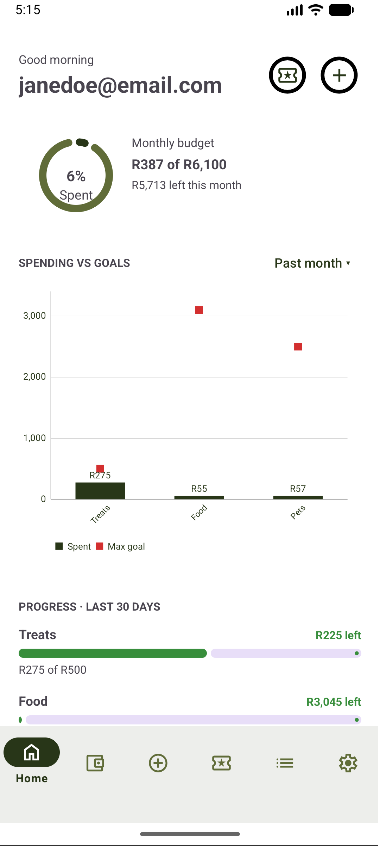
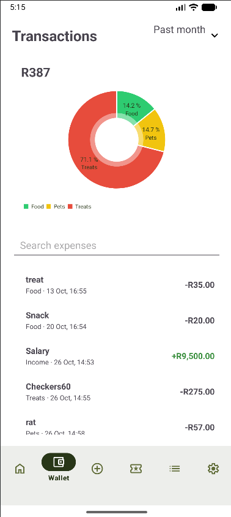
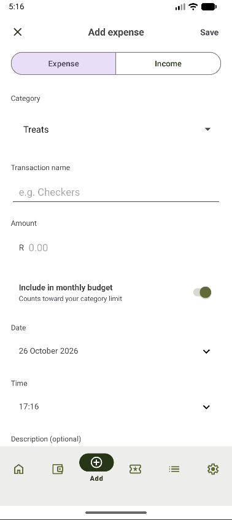
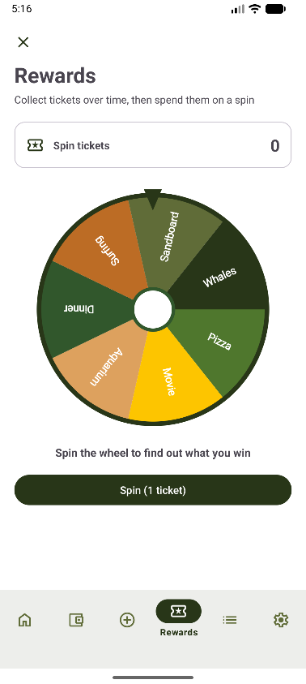
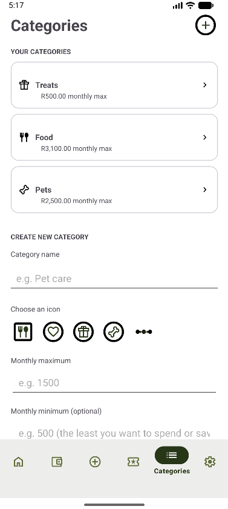
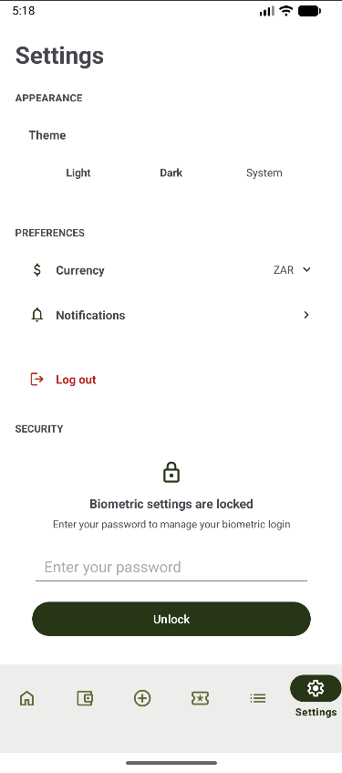

**Republic Savings**

A budgeting app for people who want to take real control of their money. Built for Android, Republic Savings is designed around the South African cost of living, where every rand counts and knowing where it went matters.
Most budgeting apps connect to your bank and log everything automatically. We chose a different approach: you log your own expenses. It keeps you accountable, and it keeps you aware of your spending habits.

A demonstration and user starter guide can be located on youtube at: https://youtu.be/akCPWiPvqs0

  
  
  

- **Budgets per category.** Every category has a monthly maximum and an optional minimum goal. Categories can be created, edited and deleted. The home screen shows how much of your monthly budget you have used and how much is left.
- **Expenses and income.** Log a transaction with a name, amount, date, time, description and a photo of the receipt. Switch between Expense and Income when adding. Entries can be edited or deleted from the Wallet.
- **Wallet.** A pie chart of spending per category, search by expense name or category, and a period filter (past day, week, month, 3 months, 6 months or year).
- **Spending against your goals.** A chart on the home screen shows spend per category against its minimum and maximum goal, over a period you choose. Progress bars show how each category did over the last 30 days: on track, over the maximum, or below the minimum.
- **The Fair.** Stay within your budget and you earn tickets, which you spend on a prize wheel (see below).
- **Keep it private.** Create an account and sign in with your password. Your session is remembered, and you can turn on biometric unlock. Everything you log is stored against your own account, so each person only sees their own data.
- **Make it yours.** Switch between light and dark theme (your choice is remembered) and choose your currency, which is applied across the whole app, including the charts.

  
  
  

## Our unique features

### 1. The Fair (Ember Jones)

Staying within budget earns tickets, and tickets are spent on a prize wheel.

- Your budget is the sum of your category monthly maximums, and your daily allowance is that budget divided by the number of days in the month.
- A **week** (Monday to Sunday) earns a ticket when it has finished, has at least one logged expense, every day stayed within the daily allowance, and at least R100 was saved against the allowance.
- A **month** earns a ticket when every Monday-to-Sunday slice inside it stayed within the allowance and at least R100 was saved against the monthly budget.
- Only expenses marked "include in budget" count. Income is ignored.
- Each ticket gives one spin. Prizes come in three tiers: R100 (pizza, movie tickets), R300 (aquarium tickets, a nice dinner) and R500 (surfing gear rental, sandboarding, a whale watching tour). Which tiers a ticket can win depends on how much was saved, and the wheel shows exactly the prizes that ticket can win.
- Tickets are worked out when the Fair screen opens. The ticket count is stored on the user's document in Firestore (`tickets`) together with the list of weeks and months already awarded (`fairAwarded`). Awards and spins are saved in transactions, so a ticket can never be awarded or spent twice. Each prize is saved in a prize history on the device.

### 2. Biometric unlock (Reatile Tsiboho)

When biometric unlock is turned on, reopening the app asks for the phone's lock (fingerprint, face or PIN) before the saved session is opened. If it fails or is cancelled, the user is returned to the login screen.

## Getting started

1. Open the app and create an account.
2. Choose your currency and, if you like, turn on biometric unlock.
3. Create your categories with a monthly maximum (and a minimum if you want one).
4. Tap the + button whenever you spend something or get paid.
5. Check the home screen to see how you are doing against your goals, and visit The Fair once you have earned a ticket.

The video guide above walks through all of this.

## How we built it

- **Kotlin**, built in Android Studio with Gradle. Screens use XML layouts with ViewBinding and the Navigation component.
- **Firebase Firestore** is the online database. Collections: `users`, `categories` and `expenses`. Each record belongs to one user.
- **MPAndroidChart** for the pie and bar charts, **Material Components** for the UI and **Coil** for receipt images.
- The data layers are: DAO interfaces, Firestore implementations, repositories and then the screens. They are wired together in `RepublicSavingsApp`.

We used GitHub to host the project and collaborate as a team. Each of us worked on our own branches, changes were merged through pull requests, and we kept regular, clearly described commits so the project history stays easy to follow. This kept everyone's work in sync and helped us catch problems before they reached the main branch.

## Running the project

1. Clone the repository and open it in Android Studio.
2. `google-services.json` is not stored in the repository. Add the file from your own Firebase project to the `app/` folder.
3. Run the `app` configuration on a phone or emulator (Android 8.0 or newer).

## Tests and GitHub Actions

- 72 unit tests cover the Fair rules and ticket logic, the repositories and the goal progress. Run them with `./gradlew testDebugUnitTest`.
- `.github/workflows/android.yml` runs the unit tests and builds the app on every push, and uploads the debug APK as a build artifact.

## Known limitations

- Tickets are worked out when the Fair screen opens, not in the background.
- The prize history is stored on the device, so reinstalling the app clears it. Tickets are stored online and are not affected.
- The Wallet has a period filter and search, but no calendar or day view and no amount filter.
- Deleting a category keeps its expenses. They still appear in the Wallet and charts under their old category name.
  
## References
No external code was used. Claude was used to assist with code, documentation and debugging. 
Documentation for the apps Research and Design are included in the Github repo in the Docs folder.

**The Team**
Built by four Vega Cape Town Students for OPSC7311:
  Ember Willow Jones - ST10450923
  Jonty de Longchamps - ST10440393
  Devilliers Cloete - ST10443944
  Reatile Tsiboho - ST10260942
